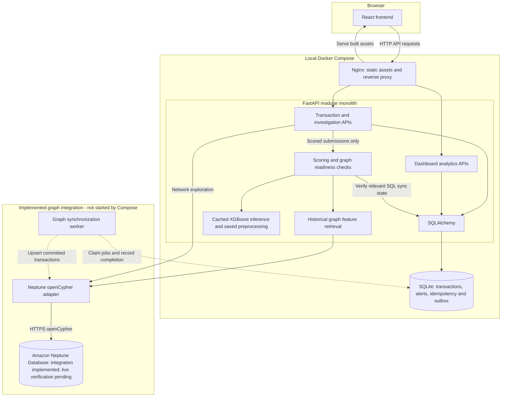
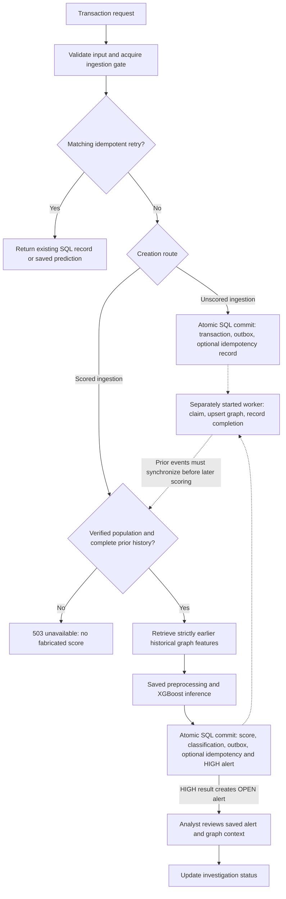

# RiskGraph — Graph-Based Fraud Detection & Investigation Platform

RiskGraph combines transaction APIs, historical graph features and a saved XGBoost
classifier with an investigation interface. A FastAPI modular monolith manages
SQL records and graph synchronization; React provides transaction review,
analytics and bounded transaction–card–device network exploration.

## Overview

A transaction's amount alone cannot show whether its card or device has appeared
in other activity. Shared card and device relationships give reviewers context
across transactions, while historical counts and associations provide inputs to
risk scoring. Connections are investigative evidence to examine, not proof of fraud.

SQL is the source of truth for accepted transactions, predictions, alerts and
synchronization state. Graph updates are delivered separately through a durable
outbox. Scoring requires verified, strictly earlier graph history before a new
prediction can be saved.

**Status:** React, FastAPI and Docker Compose are locally verified. The Amazon
Neptune adapter is implemented, but live connectivity and graph population
verification are pending. Public cloud deployment and authentication are not complete.

## Key Features

- **Transaction ingestion:** validated amounts, UTC timestamps, optional
  idempotency keys, conflict detection and paginated retrieval.
- **Graph-aware scoring:** one pretrained XGBoost classifier, saved preprocessing,
  a validation-selected threshold, and consistent HIGH/LOW classifications.
- **Transactional outbox:** transaction and synchronization job commit together;
  a separately started worker uses leases, bounded retries and idempotent graph writes.
- **Graph exploration:** bounded networks of transactions, pseudonymous cards and
  optional devices, with safe node details and synchronization readiness checks.
- **Alerts and investigations:** HIGH results create an OPEN alert atomically;
  reviewers can inspect saved signals and move alerts through OPEN, IN_REVIEW and CLOSED.
- **Analytics dashboard:** SQL-backed counts, UTC transaction trends, saved risk
  distributions and investigation status charts.
- **Local containers:** non-root FastAPI and Nginx services, health checks,
  persistent SQLite storage and an optional read-only model mount.

## System Architecture

The API and worker share the same backend modules. The worker is a separate
process from the modular monolith's codebase, with no message broker or separate
model server. Solid arrows below show request/data access; dashed arrows show
outbox processing performed outside the HTTP request.



Only Nginx publishes a host port, bound to `127.0.0.1`. The default Compose setup
starts neither the graph worker nor Neptune, and keeps scoring disabled.
The optional model bundle is mounted from local storage; it is never baked into
an image. PostgreSQL support is present in the persistence layer, with live
integration still to be verified.

## Fraud Detection Workflow

The API supports two creation paths. Unscored ingestion accepts records without
calling the graph or model. Scored ingestion evaluates a **new** transaction
against prior synchronized history, then saves the result. It does not upgrade
an already-ingested transaction ID into a scored transaction.



- Duplicate IDs, conflicting keys and rejected late events return 409. Matching
  scored retries return saved results without repeating inference.
- Graph features use UTC windows `[event_time - window, event_time)`: the lower
  boundary is inclusive; current, exact-time and future events are excluded.
- SQL persistence is atomic; graph delivery is asynchronous and uses bounded
  at-least-once retries. A graph write may be repeated after an uncertain outcome.
- HIGH means `risk_score >= saved threshold`; LOW means below it. Neither is a
  verified fraud outcome. Descriptive risk indicators do not explain the model's trees.
- The current scoring policy requires one API worker on one host with local
  file-backed SQLite, a verified graph population and complete relevant history.

This diagram describes implemented behavior when dependencies are verified and
explicitly enabled. The local Docker setup does not automatically run this full flow.

## Machine Learning

One XGBoost binary classifier was trained on **590,540 IEEE-CIS transactions**.
Chronological partitions contain 413,378 training, 88,581 validation and 88,581
test rows. Equal-time events stay together, and historical state continues across
partition boundaries without using future events or fraud labels as features.

The 17 inputs are transaction amount, ProductCD, M1–M9, `device_missing`, and:

- `card_txn_count_24h`
- `device_txn_count_24h`
- `card_unique_devices_7d`
- `device_unique_cards_7d`
- `card_avg_amount_7d`

Imputation and categorical encoding are fitted on training data only and reused
at inference. The validation partition selects the classification threshold;
the final test partition is evaluated after that threshold is fixed.

The saved evaluation records report:

| Test metric | Value |
| --- | ---: |
| ROC-AUC | 0.8044 |
| PR-AUC, reported as Average Precision | 0.1572 |
| Precision | 0.1888 |
| Recall | 0.3581 |
| F1 | 0.2472 |
| Saved classification threshold | 0.761772 |

These are offline results on one chronological split, not external validation or
measured business impact. Card/device tokens are approximate fingerprints of
anonymized attributes; they can merge unrelated identities or split one identity.
Missing device information limits graph coverage. Dataset timestamps use a
synthetic UTC reference, and inference currently enforces the prototype USD policy.

The backend loads the saved model and preprocessing once per process through a
cached predictor. Model binaries, raw/prepared datasets and generated evaluation
files are intentionally excluded from Git. The metrics above were checked against
the existing local bundle; cloning the repository does not download that bundle.
See the [classifier guide](ml_training/CLASSIFIER.md) and
[historical feature documentation](ml_training/GRAPH_FEATURES.md) for details.

## Tech Stack

| Technology | Responsibility |
| --- | --- |
| Python, FastAPI, Pydantic | HTTP APIs, validation and service orchestration |
| SQLAlchemy, SQLite | Local transactional persistence, idempotency and outbox |
| PostgreSQL / psycopg | Configurable persistence target; live verification pending |
| Amazon Neptune, openCypher | Graph adapter for relationships, traversal and history |
| XGBoost, scikit-learn | One classifier and saved preprocessing pipeline |
| React, Vite, React Router | Browser application and navigation |
| Recharts, Cytoscape.js | Analytics charts and interactive graph visualization |
| Docker Compose, Nginx | Local containers, static assets and API reverse proxy |
| pytest, Node test runner | Backend and frontend automated tests |

## Local Quick Start

Install Docker Desktop with Linux containers enabled, then run from the
repository root:

```powershell
docker compose build
docker compose run --rm --no-deps backend python -m scripts.init_db
docker compose up -d --wait
```

Open **http://127.0.0.1:8080**. A fresh database displays empty dashboard,
transaction and investigation views. Health is available at
http://127.0.0.1:8080/health; it checks SQL connectivity, not graph/model readiness.

```powershell
docker compose logs --tail 100 backend frontend
docker compose down
```

SQLite uses a persistent named Docker volume, separate from the host database.
Initialization creates missing tables explicitly; restarts do not reset data.
**Do not use `docker compose down -v` casually: it removes the database volume.**

Ordinary API and dashboard use does not require a model bundle. Graph exploration
and new scoring requests remain gated until Neptune population verification.
Keep this unauthenticated setup local and use pseudonymous demonstration data.
See [Docker setup](docs/docker-setup.md) for optional read-only model mounts,
configuration, additive migrations and troubleshooting, or the
[frontend guide](frontend/README.md) for running the development servers directly.

## Backend API Overview

| Endpoint | Purpose |
| --- | --- |
| `GET /health` | SQL connectivity check |
| `POST /api/v1/transactions` | Create an unscored transaction and outbox job |
| `GET /api/v1/transactions` | Paginated transaction records |
| `GET /api/v1/transactions/{transaction_id}` | Retrieve one saved transaction |
| `POST /api/v1/transactions/score` | Score and atomically save a new USD transaction, subject to readiness checks |
| `GET /api/v1/transactions/{transaction_id}/graph` | Bounded network for a synchronized transaction |
| `GET /api/v1/alerts` and `GET /api/v1/alerts/{alert_id}` | List and inspect saved alerts |
| `PATCH /api/v1/alerts/{alert_id}` | Update investigation status |
| `GET /api/v1/dashboard/*` | Summary, risk distribution, transaction trends and alert status |

Creation routes accept an optional `Idempotency-Key` header. Detailed request,
response and failure contracts are in the [scoring API guide](docs/scoring-api.md),
[alert API guide](docs/alerts-api.md) and [dashboard API guide](docs/dashboard-api.md).

## Testing

The latest verified application checks completed locally:

| Check | Result |
| --- | --- |
| Backend pytest suite | 553 passed |
| Frontend Node test suite | 58 passed |
| Frontend production build | Passed |
| Docker images and Compose startup | Verified locally |
| SQLite persistence after container restart/replacement | Verified locally |

Backend tests use temporary databases and fake graph dependencies; frontend tests
use synthetic fixtures and fake HTTP responses. They require no AWS access.
The full backend suite also needs the existing optional ML dependencies;
see [backend development notes](docs/scoring-api.md#local-backend-development).
From an already configured development environment:

```powershell
cd backend
python -m pytest -q -p no:cacheprovider
cd ../frontend
npm test
npm run build
```

GitHub Actions CI is not configured. Offline Neptune tests verify adapter
contracts and error handling, not query execution against a live Neptune engine.

## Current Status and Limitations

- React and FastAPI are implemented and locally tested; Docker Compose is locally verified.
- Neptune integration is coded, but actual connectivity, query execution and graph population remain unverified.
- Live graph access and scoring remain unavailable until population and freshness requirements are satisfied.
- Authentication, operator authorization and an operator audit trail are not implemented.
- Investigation updates currently use last-write-wins semantics.
- PostgreSQL integration and AWS deployment verification are pending.
- There is no public production deployment or measured scalability claim.

## Repository Structure

```text
backend/              FastAPI application, graph adapters, worker, scripts and tests
frontend/             React application, API client, visualizations and tests
ml_training/          Offline dataset preparation, historical features and training
docs/                 API contracts, integration requirements and local setup
artifacts/            Optional local model bundles (Git-ignored)
data/                 Local datasets and generated outputs (Git-ignored)
docker-compose.yml    Local FastAPI and Nginx services with persistent SQLite
docker-compose.model.yml  Optional ML runtime and read-only artifact mount
```

## Documentation

- [Docker setup and troubleshooting](docs/docker-setup.md)
- [Frontend development and interface behavior](frontend/README.md)
- [Scoring API, unscored ingestion and UTC handling](docs/scoring-api.md)
- [Inference inputs and saved preprocessing](docs/fraud-inference.md)
- [Graph synchronization and recovery](docs/graph-sync.md)
- [Neptune adapter and pending integration checks](docs/neptune-adapter.md)
- [Graph Explorer API](docs/graph-explorer-api.md)
- [Alert and investigation API](docs/alerts-api.md)
- [Dashboard API](docs/dashboard-api.md)
- [Dataset preparation](ml_training/README.md)
- [Historical graph features](ml_training/GRAPH_FEATURES.md)
- [Classifier training and evaluation](ml_training/CLASSIFIER.md)

## Roadmap

- Verify real AWS Neptune queries, graph population and PostgreSQL integration.
- Add S3 artifact storage and CloudWatch observability.
- Add GitHub Actions CI for the existing test suites and builds.
- Complete end-to-end deployment verification and access controls before public use.
